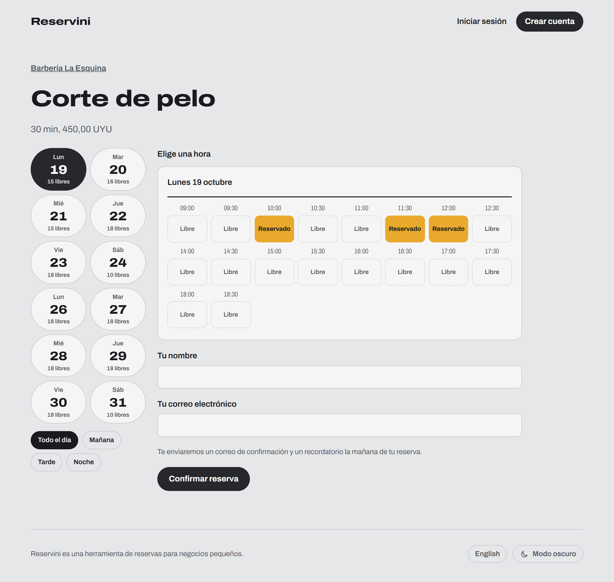
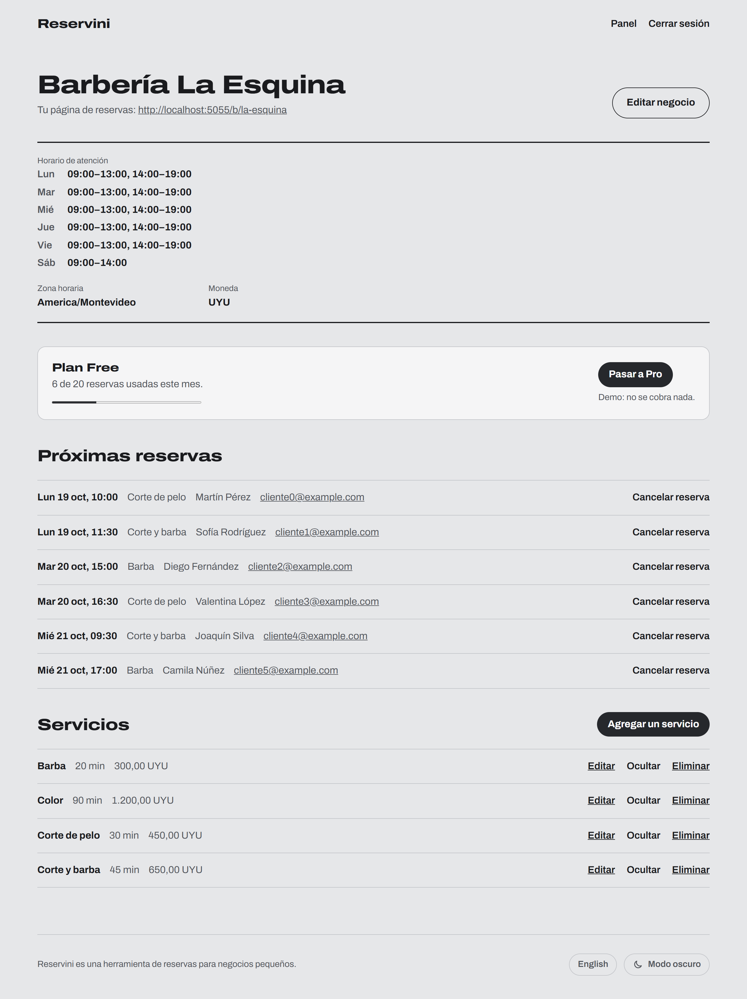
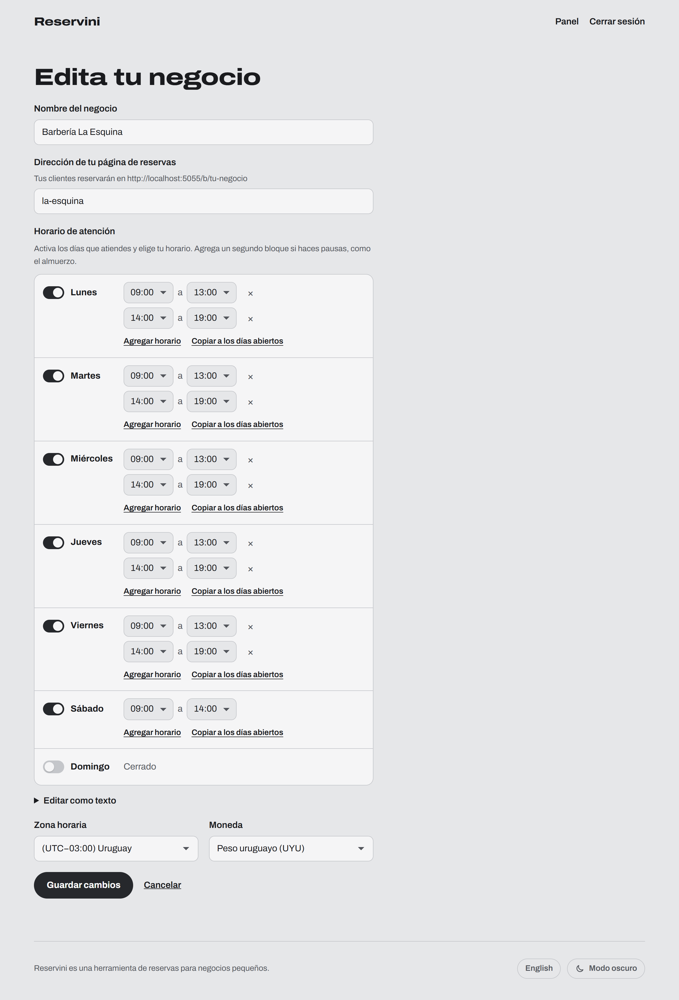

# Reservini

Reservas online para negocios chicos: barberías, profes particulares, consultorios. El dueño carga sus servicios y su horario, comparte el link de su página y los clientes eligen una hora libre sin tener que escribirle.

La app está en español e inglés, funciona con cualquier zona horaria y trae doce monedas, peso uruguayo incluido.

> Si es la primera vez que la usás, la [guía rápida](docs/GUIA.md) la recorre paso a paso con capturas.

<picture>
  <source media="(prefers-color-scheme: dark)" srcset="docs/capturas/reservar-oscuro.png">
  
</picture>

## Qué hace

- Cuentas para dueños de negocio, con registro e inicio de sesión.
- Perfil del negocio con dirección pública, zona horaria, moneda y horario semanal. El horario se arma día por día, con un interruptor y menús de hora, o escribiéndolo como texto.
- Servicios con duración y precio, que se pueden editar, ocultar o borrar.
- Página pública con las horas libres de las próximas dos semanas, filtros por día y franja horaria, y control para que nadie tome una hora ya reservada.
- Mail de confirmación al reservar y recordatorio la mañana de la reserva.
- Panel con las próximas reservas. Si el dueño cancela una, el cliente recibe un mail.
- Plan Free con 20 reservas por mes y plan Pro sin límite. El cambio de plan es de demostración y no cobra nada.
- Modo claro y modo oscuro.

<p align="center">
  <picture>
    <source media="(prefers-color-scheme: dark)" srcset="docs/capturas/panel-oscuro.png">
    
  </picture>
  <picture>
    <source media="(prefers-color-scheme: dark)" srcset="docs/capturas/horarios-oscuro.png">
    
  </picture>
</p>

## Con qué está hecha

Python y Flask, con SQLAlchemy sobre SQLite en desarrollo y PostgreSQL en producción. Flask-Login maneja las sesiones, Flask-WTF los formularios y el CSRF, Flask-Limiter frena los intentos repetidos y Flask-Babel las traducciones. El frontend es HTML y CSS, con un poco de JavaScript para el editor de horarios y los filtros de la página de reservas. Los tests son con pytest.

## Correrla en tu máquina

Necesitás Python 3.12 o más nuevo.

```bash
python -m venv .venv
.venv\Scripts\activate
pip install -r requirements-dev.txt
copy .env.example .env
```

En macOS o Linux el entorno se activa con `source .venv/bin/activate` y el archivo se copia con `cp`.

En `.env` poné un `SECRET_KEY` largo y aleatorio. Podés generarlo así:

```bash
python -c "import secrets; print(secrets.token_hex(32))"
```

Después arrancá el servidor. La base se crea sola la primera vez:

```bash
flask run
```

Queda en http://127.0.0.1:5000. Los mails solo salen si completás los `MAIL_*` de `.env` con un servidor SMTP; si no, la app anota en el log que se saltó el envío.

## Tests

```bash
python -m pytest
```

Son 83 tests y corren en GitHub Actions en cada push.

## Traducciones

Los textos están en inglés en el código y la traducción vive en `reservini/translations/es/LC_MESSAGES/messages.po`. Después de cambiar textos:

```bash
pybabel extract -F babel.cfg -k _l -o messages.pot .
pybabel update -i messages.pot -d reservini/translations
pybabel compile -d reservini/translations
```

## Recordatorios

`flask send-reminders` manda los recordatorios pendientes. Se puede correr las veces que quieras: nunca manda dos veces el mismo.

En producción, Vercel llama una vez por día a `/tasks/send-reminders`. Esa ruta solo responde si el request trae el valor de `CRON_SECRET`.

## Publicarla

Está preparada para Vercel con una base PostgreSQL en Neon:

1. Importá el repositorio en Vercel.
2. Conectá una base de Neon desde la pestaña Storage, que agrega `DATABASE_URL`.
3. Agregá `SECRET_KEY`, `CRON_SECRET`, `TRUST_PROXY=1` y, si querés mandar mails, los `MAIL_*`.

Las tablas se crean en el primer arranque. `api/index.py` es la entrada en Vercel y `vercel.json` define la región y el cron de los recordatorios.
