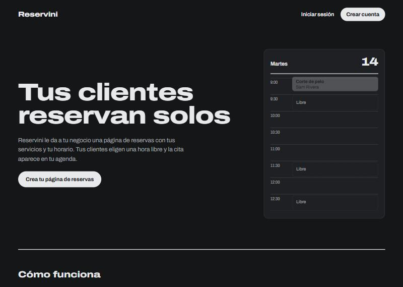
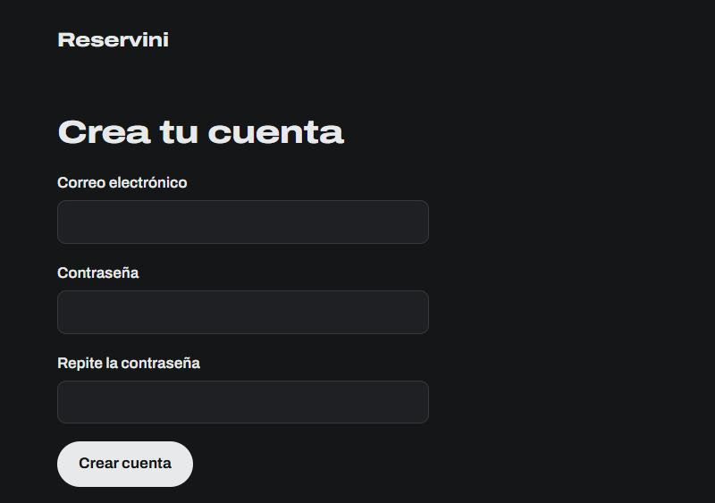
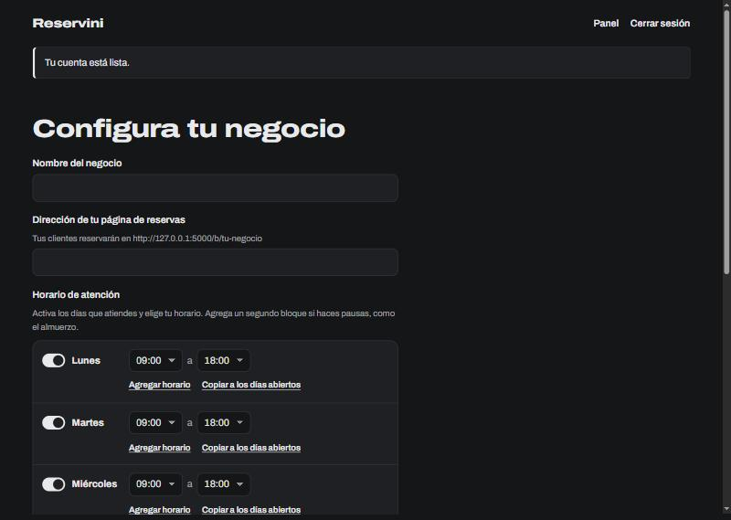
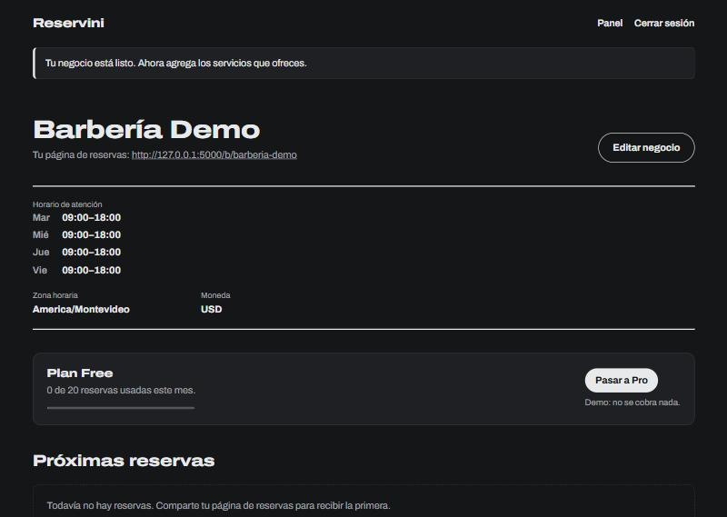
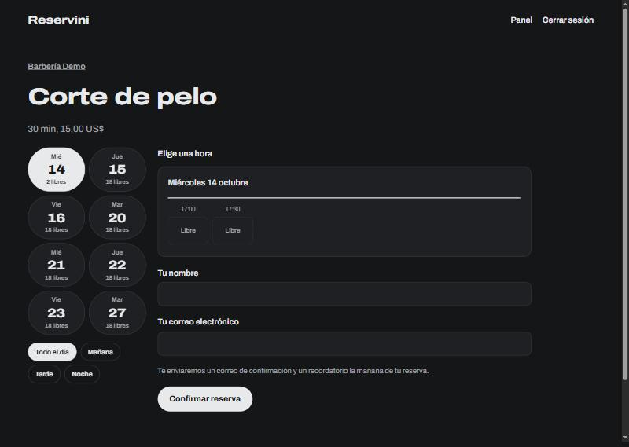

# Guía rápida de Reservini

Reservini es una herramienta de reservas para negocios chicos (barberías, profes, consultorios).
Vos armás tus servicios y tu horario, compartís un link, y tus clientes eligen una hora libre solos.

Esta guía te lleva de cero a tener tu página de reservas funcionando.

---

## 1. Instalar y arrancar

Necesitás tener **Python 3.12 o más nuevo** instalado (descargalo de [python.org](https://www.python.org/downloads/) marcando *Add python.exe to PATH*).

Abrí una terminal en la carpeta del proyecto y pegá estos comandos, uno por uno:

```bash
python -m venv .venv
.venv\Scripts\activate
pip install -r requirements-dev.txt
copy .env.example .env
```

Poné una clave secreta en el archivo `.env`. Generá una con:

```bash
python -c "import secrets; print(secrets.token_hex(32))"
```

Copiá el resultado y pegálo en `.env`, en la línea `SECRET_KEY=`.

Arrancá el servidor (la base de datos se crea sola la primera vez):

```bash
flask run
```

Abrí tu navegador en **http://127.0.0.1:5000**.

---

## 2. La página de inicio

Así se ve. Arriba a la derecha están **Iniciar sesión** y **Crear cuenta**.



---

## 3. Crear tu cuenta

Tocá **Crear cuenta**, poné tu correo y una contraseña.



---

## 4. Configurar tu negocio

Después de registrarte, cargás el nombre del negocio, la dirección de tu página de reservas
y tu horario de atención. Activás los días que trabajás y elegís las horas (podés agregar un
segundo bloque si hacés una pausa, como el almuerzo).



---

## 5. Tu panel

Este es tu panel. Muestra tu horario, el plan que tenés, las próximas reservas y el link
de tu página pública. Desde acá agregás los **servicios** que ofrecés (con duración y precio).



---

## 6. La página que ven tus clientes

Compartís el link (por ejemplo `http://tu-sitio/b/barberia-demo`). Tus clientes eligen el
servicio, ven las horas libres de las próximas dos semanas y reservan con su nombre y correo.
Reciben un correo de confirmación y un recordatorio la mañana de la reserva.



---

## Idiomas y temas

- La app está en **español** e **inglés**. Cambiás el idioma con el enlace del pie de página.
- Hay **modo claro** y **modo oscuro**, también desde el pie de página.

## Más

Para el detalle técnico completo (correos, traducciones, tests y publicar en producción),
mirá el [README](../README.md).
